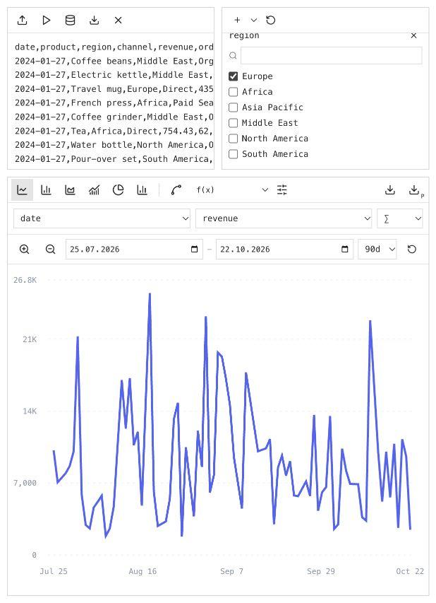
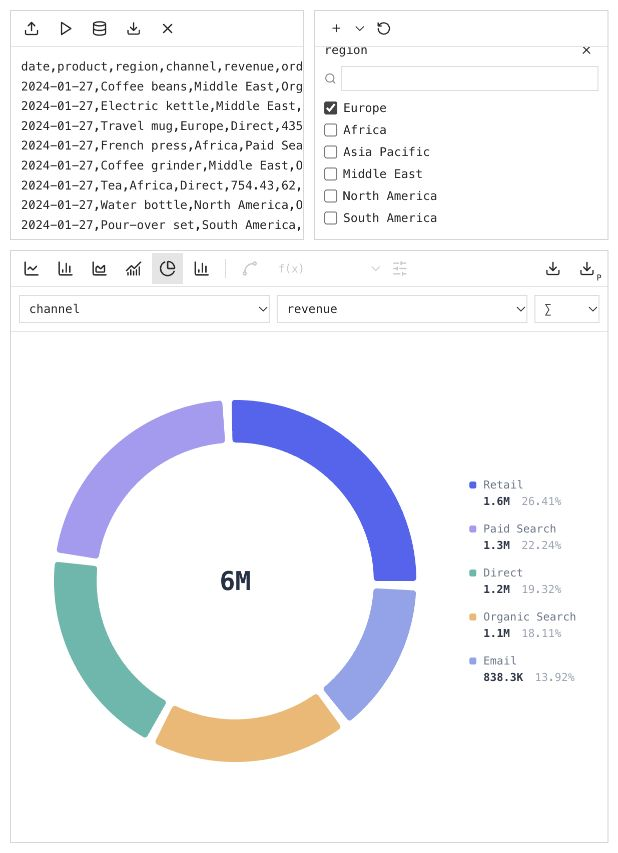
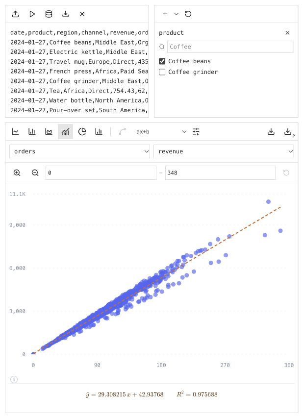

# Interactive data visualisations

A small localhost tool for CSV, TSV and JSON data. Files stay in your browser.

## Screenshots

Sales trend: narrow the date window and filter categories.



Category comparison: explore the sales mix with an interactive donut chart.



Function fit: inspect the fitted curve and its LaTeX equation.



## Run

Requirements: Node.js 22.12 or newer; npm.

```sh
npm ci
npm run dev
```

Open the localhost address printed in the terminal.

## Use

- Upload a file or paste data; press Play or Ctrl/Cmd + Enter.
- Database icon: load the 10,000-row sales sample. The next arrow downloads it.
- Pick a chart, axes and aggregation: sum, average or count.
- Plus: add filters. Magnifiers: zoom. Date fields and presets: set a time window.
- Sliders: set linear/log scale and Y bounds. Curve icon: toggle straight/smooth lines.
- f(x): fit a function and show its LaTeX equation and R².
- Download arrows: save SVG or PNG, including the fitted curve; equations stay on-screen.

Hover over controls for their names. Refreshing clears your data.

Limits: 10 MB; 50,000 rows; 100 columns. Use CSV/TSV headers, flat JSON objects and ISO dates.

## Other commands

- Run tests: `npm test`.
- Build: `npm run build`; preview the build: `npm run preview`.
- Regenerate the sample: `npm run sample`.
